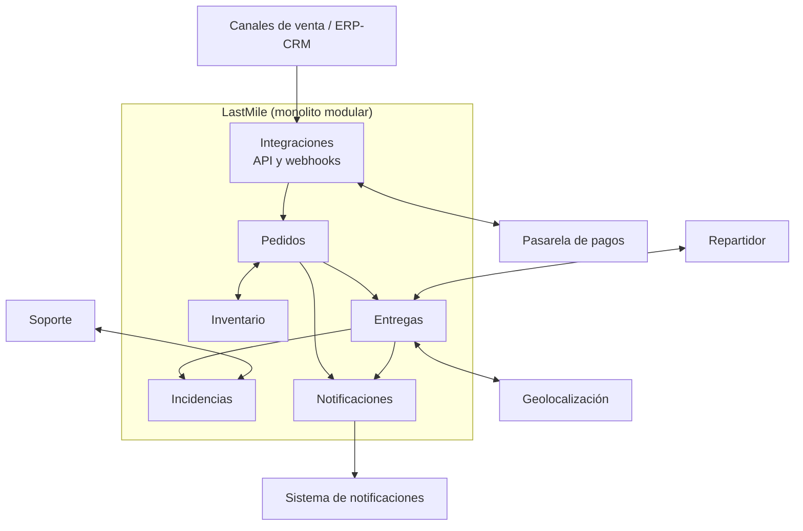

# Estructura del sistema LastMile

## Contexto

LastMile debe centralizar pedidos multicanal, consolidar inventario distribuido y automatizar la entrega de última milla. El problema central es la falta de una fuente única de verdad, que causa ventas sin stock real, entregas fallidas y sobrecarga de soporte.

Los drivers arquitectónicos son: consistencia de inventario, estado único y trazabilidad del pedido, interoperabilidad con sistemas externos, disponibilidad ante fallas parciales, evolución por módulos y protección de datos personales.

El contexto tiene incertidumbres: el volumen máximo de transacciones simultáneas es desconocido, la autonomía de los repartidores no está definida y la normativa de datos está por confirmar.

## Decisión

Se adopta un **monolito modular con límites de dominio claros**, desplegado como una sola unidad.

**Módulos (dominios):** Pedidos, Inventario, Entregas, Incidencias, Notificaciones e Integraciones.

**Reglas de la estructura:**

1. Cada módulo es dueño de sus datos; ningún módulo lee ni escribe las tablas de otro.
2. Los módulos se comunican solo por interfaces públicas o eventos internos.
3. Las integraciones externas (ERP/CRM, canales, pasarela de pagos, geolocalización, notificaciones) se aíslan en el módulo de Integraciones, detrás de contratos de API versionados.
4. La recepción de pedidos es idempotente.
5. Las llamadas a servicios externos usan cola y reintentos para que su falla no detenga el flujo principal.

## Alternativas consideradas

| Alternativa | Resultado | Motivo principal |
|---|---|---|
| A. Monolito modular con límites claros | **Elegida** (4,35) | Mejor equilibrio entre consistencia, costo, simplicidad y evolución |
| B. Arquitectura distribuida por servicios | Descartada por ahora (2,75) | Complejidad y consistencia eventual no justificadas sin evidencia de volumen |
| C. Monolito por capas tradicional | Descartada (3,95) | Evoluciona peor al no tener límites por dominio |

## Justificación técnico-negocio

- **Negocio:** el mayor dolor es vender sin stock real. Un núcleo único con reserva transaccional ataca ese problema directamente. Se entrega valor más rápido y a menor costo.
- **Técnica:** al estar los módulos de Pedidos e Inventario en la misma unidad, la reserva de stock puede resolverse con una transacción local, sin la consistencia eventual que traería un sistema distribuido.
- **Riesgo:** reduce el riesgo operativo (menos infraestructura, menos puntos de falla de red) en un contexto con volumen y autonomía de repartidores aún desconocidos.
- **Evolución:** los límites por dominio dejan abierta la extracción de servicios cuando haya evidencia que la justifique.

## Consecuencias y trade-offs

**Positivas**

- Menor tiempo de construcción y costo de operación.
- Consistencia de inventario más simple de garantizar.
- Trazabilidad y depuración más directas (un solo proceso y una sola base de datos).

**Negativas / trade-offs aceptados**

- Se escala la aplicación completa, no módulos individuales.
- Una falla grave del proceso puede afectar a todos los módulos.
- Un solo despliegue implica que cambios en cualquier módulo exigen desplegar todo.
- Los límites se sostienen por disciplina y pruebas; si se relajan, el sistema se acopla.

## Riesgos y mitigaciones

| Riesgo | Mitigación |
|---|---|
| Los módulos se acoplan con el tiempo | Reglas de dependencia verificadas automáticamente en pruebas; revisión de límites en cada entrega |
| El volumen supera lo previsto | Pruebas de carga tempranas; escalar horizontalmente la aplicación; reevaluar con los disparadores |
| Falla de un servicio externo detiene la operación | Cola, reintentos y estados intermedios (ver QS-04 y QS-05) |
| Datos personales sin normativa definida | Cifrado y control de acceso desde el inicio; confirmar la normativa antes de producción |
| Desconexión del repartidor | Modo con sincronización diferida (QS-07) |

## Disparadores para reevaluar la decisión

Se reabre este ADR y se evalúa extraer servicios si ocurre alguno:

1. La carga sostenida supera la capacidad de escalar el monolito de forma económica (por ejemplo, el módulo de Entregas requiere escala muy distinta al resto).
2. Aparecen equipos independientes que necesitan desplegar un módulo con ritmo propio.
3. Un módulo exige una tecnología o nivel de disponibilidad distintos al resto.
4. Las pruebas de dependencia muestran acoplamiento que no se puede corregir dentro del monolito.

El candidato natural a extraer primero sería **Entregas** (telemetría, alto volumen de eventos) o **Notificaciones**.
